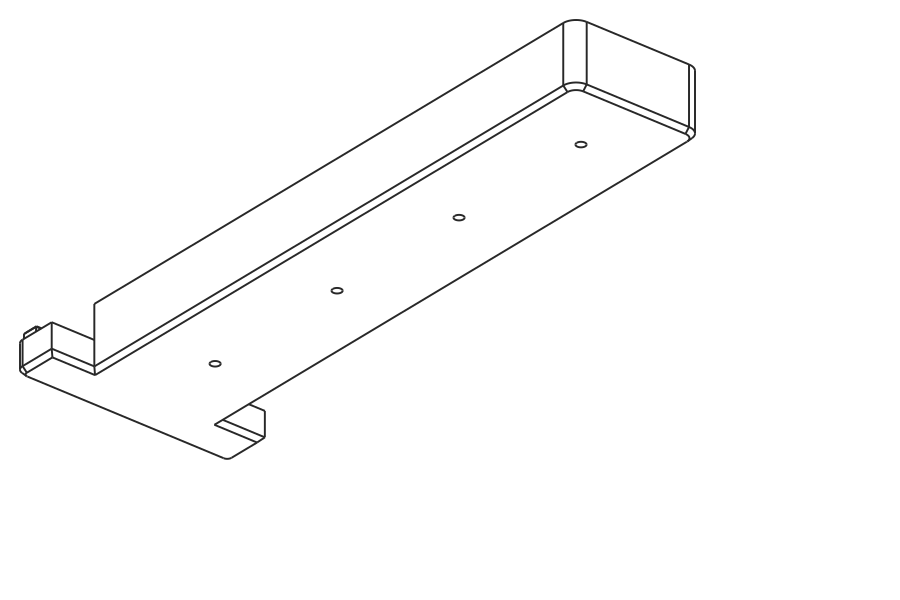
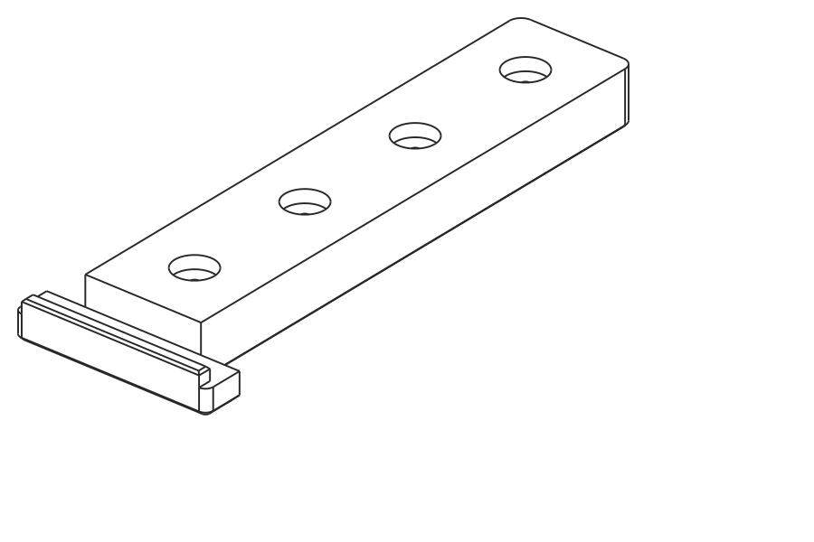
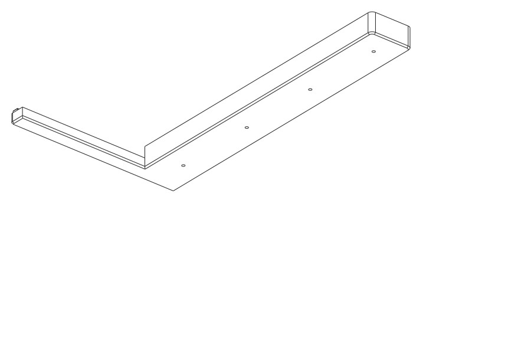
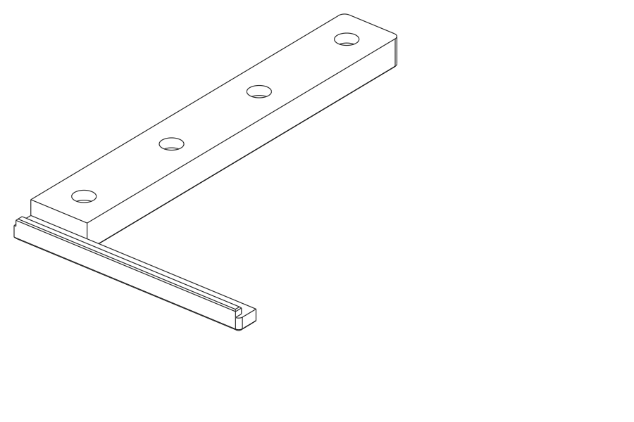

# Dahle 533 – Anschlagschieber zum Selberdrucken

Ersatz für den verlorenen Rückanschlag der Hebelschneidemaschine Dahle 533 (Original: „Rückanschlag 613“,
Dahle 00613-17229), gedruckt aus PETG auf dem Bambu Lab P1P. Dazu ein Konzept für einen nachrüstbaren
Schnittlinien-Laser: [docs/laser.md](docs/laser.md).

**Stand 2026-11-17:** Modell, Passprobe und Projektdateien für Bambu Studio sind fertig und auf die **gemessene** Schiene
ausgelegt. Vor dem großen Druck die Passprobe drucken (siehe [TODO.md](TODO.md)).

## Wie der Anschlag funktioniert

Die 533 hat zwei Winkelanlagen (graue Kunststoffschienen, vorne und hinten am Tisch; die mm-Skala ist daneben
auf den Tisch gedruckt). Jede besteht aus einem niedrigen inneren Steg, einer Nut und einem höheren äußeren Steg. Der Original-Anschlag ist ein Balken
von etwa 135 × 30 mm, der parallel zum Messer auf dem Tisch liegt, mit einer Zunge in die Nut greift und
magnetisch am Stahltisch haftet. Das Papier liegt an der Winkelanlage und an der langen Seite des Balkens an.

Der Nachbau macht dasselbe, ohne bewegliche Teile:

| Merkmal | Ausführung |
|---|---|
| Balken | 135 × 30 × 14 mm, beide langen Seiten sind Anschlagflächen (für beide Winkelanlagen) |
| Kopf | 50 mm breit über dem inneren Steg, Zunge 46 mm lang in der Nut – hält den Balken rechtwinklig |
| Halt | 4 Scheibenmagnete Ø10 × 3 mm, 0,3 mm versenkt (kratzen nicht) |
| Ablesen | direkt an der Anschlagfläche – sie läuft auf dem Tisch über die mm-Skala |
| Druck | Oberseite auf dem Druckbett, ohne Stützen, 62 min, 30 g PETG |




## Variante: asymmetrisch

Zweites Modell für die **vordere** Winkelanlage (Messer rechts): Balken 200 mm, Führung 120 mm lang und nur vom
Messer weg, zur Messerseite bündig mit der Anschlagfläche. Die lange Führung ist der Zweck: Das leichte Spiel,
das der Schieber zum Verschieben braucht, wirkt sich über 117 mm Zungenlänge kaum noch aus.

| Merkmal | Ausführung |
|---|---|
| Balken | 200 × 30 × 14 mm, Anschlagfläche ist die bündige Seite zum Messer |
| Führung | durchgehende starre Zunge, 3,8 mm dick in der 4,0-mm-Nut: 0,2 mm Spiel = höchstens 0,34 mm am Balkenende, solange die ganze Zunge in der Nut steckt; keine Federn, keine beweglichen Teile |
| Halt | 4 vorhandene Magnete (Ø ca. 9,7 × 4,4 mm) im Balken, Taschen Ø10,1 × 4,7 mm von unten, 2-mm-Loch zum Ausdrücken |
| Druck | Oberseite auf dem Druckbett, ohne Stützen, 91 min, 47 g PETG |




Die Schiene reicht laut Foto von etwa 3,0 bis 26,8 cm: Nahe am Messer steht der vordere Teil der Führung frei,
bei 21 cm (A4) der hintere. In Messernähe stecken noch rund 90 mm Zunge in der Nut, bei 21 cm rund 57 mm –
dort wächst das mögliche Spiel am Balkenende von 0,34 auf etwa 0,7 mm (0,2 mm auf 57 mm, mal 200 mm).

Beim Einstellen den Schieber leicht zur Tischmitte ziehen oder zur Schiene drücken – immer gleich –, dann liegt
die Zunge an derselben Nutflanke an und das Spiel fällt aus der Messung heraus.

Verlauf: Die erste Passprobe (eine beidseitig eingespannte Feder nahe der Anschlagfläche, 0,7 mm Vorspannung)
war viel zu stramm und lag in Messernähe außerhalb der Schiene; die Magnettasche passte. Die zweite Fassung
hatte 3,5 mm Zunge und zwei weiche Federzungen; auf Wunsch sind es 3,8 mm und keine Federn (2026-11-17). Die Nut
ist nur oben gemessen (4,0 mm) – klemmt die Zunge in der Tiefe oder über die Länge, `luft_nut` auf 0,3 stellen.

Stellschrauben in `cad/masse.toml`, Abschnitt `[asym]`: `luft_nut` (Spiel der starren Zunge);
`federn = [32.0, 91.0]` baut die zwei Federzungen wieder ein. Für die hintere Winkelanlage baut
`schiene = "hinten"` das Spiegelbild.

## Maße der Winkelanlage

Gemessen am 2026-11-16 mit dem Messschieber ([Fotos](docs/fotos/)). Querschnitt, Blick entlang der Schiene:

```
   Tischkante                                   Tischmitte (Papier)

              ┌─────────┐
              │         │◄─ C ─►┌───────┐ ─┬─        ─┬─
            E │  außen  │       │ innen │  │ D        │ B
              │         │───────│       │ ─┴─         │
  ════════════╧═════════╧═══════╧═══════╧═════════════╧═══  Tisch
              ◄──────────── 18,0 ───────►
                                ◄── A ──►
```

| | Maß | Wert | Herkunft |
|---|---|---|---|
| A | Breite des inneren Stegs | 6,5 mm | gemessen |
| B | Höhe des inneren Stegs über dem Tisch | 7,0 mm | gemessen |
| C | Breite der Nut | 4,0 mm | gemessen |
| D | Tiefe der Nut, ab Oberkante innerer Steg | 3,5 mm | gerechnet: 7,0 − (9,5 − 6,0); die Stirnansicht im Foto zeigt 3,5–4,1 |
| E | Höhe des äußeren Stegs über dem Tisch | 9,5 mm | gemessen |
| – | Gesamtbreite | 18,0 mm | gemessen; äußerer Steg damit 7,5 mm |

Der Schieber hat dazu 0,3 mm Luft je Seite in der Nut, 0,5 mm über dem inneren Steg und 0,6 mm zum Nutgrund.

Die Werte stehen in [cad/masse.toml](cad/masse.toml). Nach einer Änderung neu bauen:

```bash
uv run cad/bauen.py 2>&1 | cat      # Modelle (STL, STEP, Bilder)
druck/projekt.sh                    # Projektdateien für Bambu Studio (ohne G-Code)
```

`bauen.py` prüft die Maßkette und bricht mit einer Meldung ab, wenn z. B. die Zunge zu dünn würde.

## Drucken

Je Variante eine Projektdatei für Bambu Studio mit zwei Platten – Platte 1 ist die Passprobe, Platte 2 der
Schieber. Die Dateien enthalten **keinen G-Code**: in Bambu Studio öffnen, Filament und Platte prüfen, die Platte
slicen und senden. Voreingestellt sind die unveränderten Systemprofile – Bambu Lab P1P 0,4 mm, 0.20mm Standard,
Generic PETG –, alles dort umstellbar. Beide Platten stehen in den Platteneinstellungen auf „Engineering Plate“
(Bett 70 °C); der globale Plattentyp oben in Bambu Studio zeigt dagegen die zuletzt benutzte Platte, er kommt
nicht aus der Datei.

| Datei | Platte 1: Passprobe | Platte 2: Schieber |
|---|---|---|
| [druck/dahle533_asymmetrisch.3mf](druck/dahle533_asymmetrisch.3mf) | ganze Führung und eine Magnettasche, etwa 33 min, 13 g | etwa 91 min, 47 g |
| [druck/dahle533_symmetrisch.3mf](druck/dahle533_symmetrisch.3mf) | 12 mm breite Scheibe des Kopfs, etwa 22 min, 3 g | etwa 62 min, 30 g |

Zeit und Gewicht stammen aus einem Probeslice mit diesen Systemprofilen; mit anderen Profilen weichen sie ab.

Was zum Teil gehört, steht als Objekteinstellung in der Datei und gilt über jedem Prozessprofil: 3 Wände,
5 Deck- und 4 Bodenschichten, 20 % Gyroid, keine Stützen, 5 mm Brim außen. Die Teile liegen mit der Oberseite
auf dem Bett; Zunge und Magnettaschen zeigen nach oben.

Ohne Projekteinstellungen geht es nicht: Fehlen sie, meldet Bambu Studio „von einer alten Version erzeugt, nur
Geometriedaten werden geladen“ und verwirft Platten und Objekteinstellungen (so geschehen am 2026-11-17).

**Warping:** Die Teile sind lang und schmal und liegen flach auf dem Bett – dafür ist PETG empfindlich, wenn
Zugluft über das Bett streicht. Deshalb der Brim. Am Drucker: Vorderseite schließen (oben darf offen bleiben),
Platte entfetten, Teil erst abnehmen, wenn das Bett abgekühlt ist. Hebt es sich trotzdem, im Filamentprofil den
Bauteillüfter senken (Systemprofil Generic PETG: 40–90 %; 20–50 % reichen für diese Teile). Den Brim nach dem
Druck abbrechen und die Kante der Oberseite entgraten.

Bis 2026-11-17 waren die Dateien fertig gesliced – mit einem falschen Start-G-Code (allgemeiner Ersatz statt der
Startroutine des P1P, weil die Profile für die Kommandozeile unvollständig waren). Ältere Kopien nicht mehr
drucken.

**Passprobe asymmetrisch:** auf die vordere Winkelanlage setzen. Sie soll von selbst in die Nut fallen und sich
über die ganze Schiene leicht schieben lassen. Am Ende der Führung quer wackeln: höchstens 0,2 mm Spiel.

**Passprobe symmetrisch:** auf die Winkelanlage setzen – der Klotz liegt auf dem Tisch, die Zunge steckt in der Nut.
Sie soll ohne Druck hineinfallen und sich entlang der Schiene leicht schieben lassen; quer dazu darf sie höchstens
0,6 mm wackeln. Klemmt oder schlackert sie, `[spiel] nut_seitlich` in `cad/masse.toml` ändern.

## Zusammenbauen und benutzen (symmetrische Variante)

1. Mit einem beliebigen Magneten prüfen, dass er am blauen Tisch haftet. Dann vier Magnete Ø10 × 3 mm (supermagnete S-10-03-N, N42, Haftkraft 1,8 kg) mit einem Tropfen Sekundenkleber
   in die Taschen an der Unterseite drücken. Durch das 2-mm-Loch lässt sich ein Magnet von oben wieder
   herausdrücken.
2. Schieber auf die Winkelanlage setzen: Zunge in die Nut, Balken auf den Tisch.
3. Auf das Maß schieben und dabei leicht **gegen die Schiene** drücken – die Stirnfläche des Balkens liegt dann
   an der Innenkante der Winkelanlage an und der Balken steht rechtwinklig. Abgelesen wird an der dem Messer
   zugewandten langen Seite.

## Ordner

| Ordner | Inhalt |
|---|---|
| [cad/](cad/) | `masse.toml` (alle Maße), `bauen.py` (CadQuery-Modell) |
| [modelle/](modelle/) | STL (in Drucklage) und STEP |
| [druck/](druck/) | Projektdateien (3MF, ohne G-Code), `projekt.sh` baut sie, `platten.py` (je Modell eine Platte, Objekteinstellungen), `profile_bauen.py` und `profil/` (ausgeschriebene Systemprofile für die Kommandozeile), `probeslice.py` (Kontrolle) |
| [docs/](docs/) | Laser-Konzept, Bilder, Fotos der Maschine und der Messungen |

## Quellen

- Original und Fotos: [Dahle Rückanschlag 613 bei DynaTech](https://www.dynatech.de/dahle-rueckanschlag-613-schneidemaschine-533-534-560-561-neues-altes-design),
  [Datenblatt Dahle 533](https://assets.office-discount.at/img/24/21/i1578773.pdf)
- Magnet: [supermagnete S-10-03-N](https://www.supermagnete.de/eng/disc-magnets-neodymium/disc-magnet-10mm-3mm_S-10-03-N)
