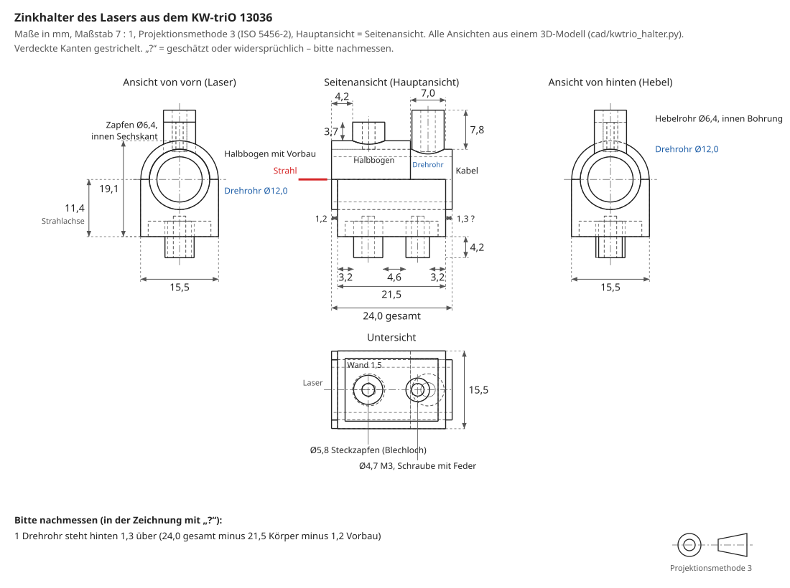
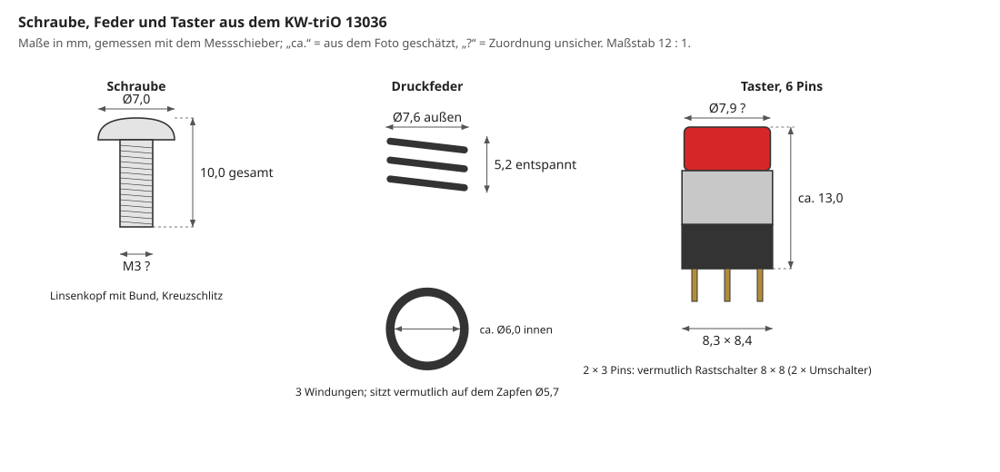
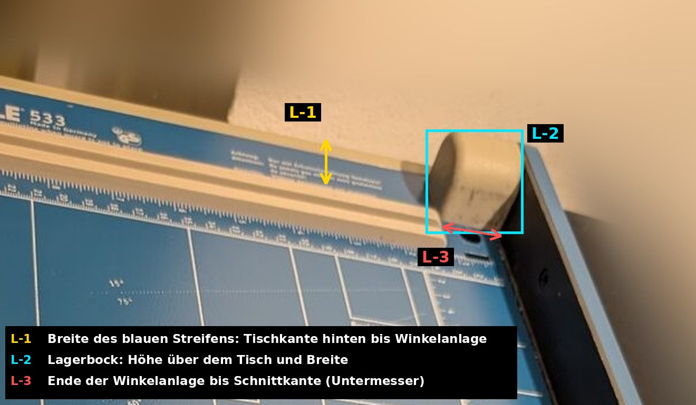

# Schnittlinien-Laser zum Nachrüsten – Konzept

**Konzept ohne Druckteil.** Verwendet wird der Laser aus einem vorhandenen Hebelschneider KW-triO 13036 („Paper
Guillotine with Laser Positioning System“, A4) – ein gekauftes Modul ist nicht vorgesehen.

## Prinzip

Ein Linienlaser spannt eine Lichtebene auf. Liegt die Schnittkante (Kante des Untermessers) in dieser Ebene,
zeichnet der Laser die Schnittlinie auf das Papier – egal, wo in der Ebene er sitzt.

- **Ort:** oben auf dem Lagerbock am Drehpunkt, auf einem gedruckten Sattel. Das Messer dreht sich um die Achse
  des Lagerbocks und schwenkt rechts der Schnittebene; der Laser sitzt links davon, so nah an der Schnittebene wie
  der Messerarm zulässt.
- **Höhe:** Strahl etwa 43 mm über dem Tisch (Lagerbock 31,6 mm, Strahlachse 11,4 mm über der Unterseite des
  Zinkhalters). Ein seitlicher Abstand a zur Schnittebene versetzt die Linie auf einem Papierstapel der Höhe t um
  t × a / 43 – bei a = 5 mm ist das ein Neuntel der Stapelhöhe.
- **Neigung:** etwa 50° nach unten, über einen Keil im Sattel; der flachste Strahl bleibt unter der Waagerechten.
- **Nicht** am Messerarm (bewegt sich) und nicht über der Tischmitte (stört beim Arbeiten).

## Laser aus dem KW-triO

| Teil | Befund | Verwendung an der 533 |
|---|---|---|
| Lasermodul | Messinghülse mit Linienoptik, rotes und schwarzes Kabel, Laserklasse 2 laut Typenschild des Geräts, Leistung nicht angegeben (Klasse 2: sichtbar, höchstens 1 mW) | so wie es ist, im Zinkhalter |
| Zinkhalter | Druckgussblock, darin das Drehrohr Ø12 mit dem Modul; Hebelrohr auf dem Drehrohr zum Drehen der Linie, Zapfen mit Innensechskant zum Klemmen; unten Steckzapfen Ø5,8 und Gewindezapfen Ø4,7 für M3-Schraube mit Feder | ganzer Block auf dem Sattel: Steckzapfen in ein Loch, M3-Schraube mit Feder; Drehen über das Hebelrohr wie im KW-triO |
| Taster und Kontakte | roter Rastschalter, Batteriefedern für 2 × AAA (3 V), angelötet | Batteriefach im gedruckten Teil mit diesen Federn und dem Taster |

Modell und Zeichnung erzeugt [cad/kwtrio_halter.py](../cad/kwtrio_halter.py) aus einer Maßtabelle; das STEP-Modell [modelle/kwtrio_halter.step](../modelle/kwtrio_halter.step) dient später als Aussparung im Sattel.

Das Modul stammt aus einem Gerät für unter 35 € und hat kein Datenblatt. Die Klassenangabe eines Billiggeräts ist
nicht verlässlich – die Auslegung mit Fächer nur auf den Tisch hält auch ein stärkeres Modul unter Augenhöhe.

## Einstellen

| Einstellung | Wie |
|---|---|
| Linie auf die Schnittkante drehen | Drehrohr über das Hebelrohr drehen, Stellschraube im Sattel drückt dagegen |
| Linie seitlich verschieben | Zinkhalter auf dem Sattel quer verschieben (Langloch für die M3-Schraube) |
| Linie dünner machen | aufsteckbare Schlitzblende (0,8 mm) vor der Optik |

Gerichtet wird einmal: Blatt schneiden, Schnittkante liegen lassen, Linie darauf einstellen.

## Maße an der 533

Gemessen mit dem Messschieber, alle ab der hinteren Winkelanlage:

| | Maß | Wert |
|---|---|---|
| L-1 (Streifen hinter der Schiene) | Winkelanlage bis Kante der blauen Tischfläche | 38,4 mm |
| | Winkelanlage bis Außenkante des grauen Rahmens | 51,4 mm |
| L-2 (Lagerbock) | grauer Zylinder am Drehpunkt: Länge entlang der Schiene | 31,5 mm |
| | Durchmesser | 31 mm |
| | Höhe über dem Tisch | 31,6 mm |
| L-3 (Schienenende) | Ende der Winkelanlage bis Schnittkante | 32,2 mm |
| | Ende der Winkelanlage bis Ende der blauen Tischfläche | 29,5 mm |

Was daraus folgt:

- Der Lagerbock füllt die Lücke zwischen Schienenende und Schnittkante fast ganz (31,5 von 32,2 mm) und ist
  31,6 mm hoch. Niedrig in der Schnittebene wie im KW-triO ist hinten kein Platz – der Laser kommt oben auf den Bock.
- Der Sattel kann sich zusätzlich an der hinteren Winkelanlage abstützen; der blaue Streifen dahinter ist 38,4 mm
  breit.

## Offene Maße

| | Maß | wofür |
|---|---|---|
| L-8 (Fächerwinkel) | Laser 100 mm über dem Tisch senkrecht nach unten halten, Länge der Linie messen | reicht der Fächer von 43 mm Höhe über 340 mm? Neigung des Keils |
| L-10 (Messerarm) | Abstand der Messer-Innenseite (Tischseite) von der Schnittkante, oben am Lagerbock | wie nah der Laser an die Schnittebene darf |

## Risiken

| Risiko | Wahrscheinlichkeit | Folge |
|---|---|---|
| Linie im Nahbereich 1–2 mm dick statt haarfein | wahrscheinlich | Schlitzblende aufstecken (10 min Druck) oder an einer Linienkante orientieren |
| Linie am vorderen Ende (flacher Einfall) bei hellem Licht blass | möglich | Sattel höher (Parameter, Neudruck 1 h) |
| Fächer zu schmal für 340 mm aus 43 mm Höhe | möglich, L-8 zeigt es | Sattel höher (Parameter, Neudruck 1 h) |
| Halter wird angestoßen und verstellt sich | gelegentlich | 1 min neu richten |

Die Einstufung als Laserklasse 2 stammt vom Typenschild des KW-triO; das ist eine Einschätzung, keine
Rechtsberatung, ohne Gewähr.
