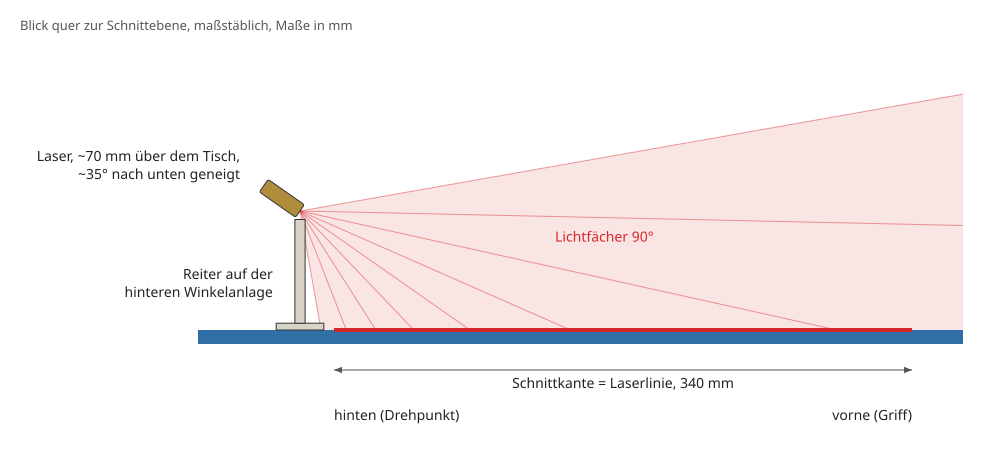

# Schnittlinien-Laser zum Nachrüsten – Konzept

**Konzept ohne Druckteil.** Der Halter braucht die drei Maße aus dem Abschnitt „Offene Maße“ – ohne sie wäre er
geraten.

Aus den Fotos der Maschine ([docs/fotos/](fotos/)): Hinter der hinteren Winkelanlage liegt ein blauer Streifen
Tisch von rund 20 mm (mit dem Dahle-Schriftzug), die Winkelanlage hat dieselbe Nut wie vorne (4,0 mm breit), und
entlang der Schnittkante ist keine Schutz- und Anpressleiste montiert – die Lichtebene hat dort freie Bahn.

## Prinzip

Ein Linienlaser spannt eine Lichtebene auf. Liegt die Schnittkante (Kante des Untermessers) in dieser Ebene,
zeichnet der Laser die Schnittlinie auf das Papier – egal, wo in der Ebene er sitzt.

- **Ort:** hinten am Drehpunkt des Messers, auf einem Reiter, der wie der Anschlagschieber mit einer Zunge in der
  Nut der hinteren Winkelanlage sitzt. Der Laser steht wenige Millimeter links der Schnittebene (Tischseite) –
  rechts davon schwenkt das Messer.
- **Nicht** am Messerarm (bewegt sich) und nicht über der Tischmitte (stört beim Arbeiten).
- **Warum Laserklasse 1:** der Fächer zeigt in Richtung der Person am Griff. Klasse 1 ist auch beim direkten
  Blick in den Strahl ungefährlich; Module mit 5 mW ohne Klassenangabe sind dafür ungeeignet.

## Lasermodul

Picotronic **L650-1-3(9x26)**, Artikel 70131109, 33,90 € ([Datenblatt/Shop](https://shop.picotronic.de/de/p/70131109)),
beim Hersteller in Koblenz bestellbar.

| Datenblatt | Wert | Prüfung gegen die 533 |
|---|---|---|
| Laserklasse / Leistung | 1 / 1 mW, 650 nm rot | augensicher ✓ |
| Öffnungswinkel | 90° | nötig sind 63° (Laser 70 mm hoch, 20 mm hinter dem Linienanfang, Linie 340 mm) ✓ |
| Gehäuse | Ø9 × 26 mm, Messing, 6 g, Kabel 115 mm | bestimmt die Aufnahme im Halter |
| Betriebsspannung | 2,5–5 V, typisch 3 V, 30 mA | 2 × AAA (3 V) reichen etwa 30 Stunden |
| Liniendicke | < 1,2 mm in 1 m (Fokus fest auf 1 m) | **im Nahbereich 0,1–0,4 m nicht angegeben**, siehe Risiken |
| Betriebstemperatur | 15–30 °C | Innenraum ✓ |

Strom: Batteriehalter 2 × AAA mit Schalter (Reichelt, Berrybase). Nicht direkt an USB – 5 V ist die Obergrenze
des Moduls, USB-Netzteile liefern bis 5,25 V.

Alternative mit einstellbarem Fokus (dünnere Linie): Picotronic LC650-5-3-F(14x45), Klasse 1, aber 153,90 €.

### Alternative: Laser aus dem KW-triO 13036

Der Laser eines vorhandenen Hebelschneiders KW-triO 13036 („Paper Guillotine with Laser Positioning System“, A4,
315 mm Schnittlänge) ist ausgebaut. Er saß dort am Drehpunkt, knapp über dem Tisch, und zeichnete die Schnittlinie
entlang der Schnittkante – dieselbe Lage wie im Konzept, nur niedriger.

| Teil | Befund | Verwendung an der 533 |
|---|---|---|
| Lasermodul | Messinghülse mit Linienoptik, rotes und schwarzes Kabel, Laserklasse 2 laut Typenschild des Geräts, Leistung nicht angegeben (Klasse 2: sichtbar, höchstens 1 mW) | so wie es ist, im Zinkhalter |
| Zinkhalter | Druckgussblock mit zylindrischer Aufnahme für das Modul; vorderer Ring mit seitlichem Zapfen (Hebel zum Drehen der Linie); Befestigung am Blechrahmen mit Schraube und Druckfeder, dazu eine Madenschraube mit Innensechskant zum Kippen | ganzer Block wird am Reiter angeschraubt; Drehen und Kippen wie im KW-triO, mit Stellschrauben im gedruckten Teil |
| Taster und Kontakte | roter Drucktaster, Batteriefedern für 2 × AAA (3 V), angelötet | Batteriefach im gedruckten Teil mit diesen Federn und dem Taster – oder ein gekaufter Batteriehalter 2 × AAA mit Schalter |

Das Modul stammt aus einem Gerät für unter 35 €: Linienqualität und Leistung sind ohne Datenblatt (L-7). Die
Klassenangabe eines Billiggeräts ist nicht verlässlich – die Auslegung mit Fächer nur auf den Tisch und Blende hält
auch ein stärkeres Modul unter Augenhöhe.

Niedrig montiert braucht der Reiter keinen hohen Ausleger, und das Licht bleibt nahe am Tisch, weit unter Augenhöhe.
Ob der Laser bei der 533 niedrig sitzen kann oder über den Lagerbock hinwegsehen muss, entscheidet L-2.

## Halter (geplant)

| Einstellung | Wie |
|---|---|
| Linie seitlich verschieben | Reiter auf der Winkelanlage verschieben |
| Linie parallel zur Schnittkante drehen | Modul in seiner Hülse drehen, über einen Hebel mit M3-Stellschraube – 1/10 Umdrehung ≈ 0,25 mm am vorderen Linienende |
| Linie dünner machen | aufsteckbare Schlitzblende (0,8 mm) vor der Optik |

Gerichtet wird einmal: Blatt schneiden, Schnittkante liegen lassen, Linie darauf einstellen.

## Offene Maße

| | Maß | wofür |
|---|---|---|
| L-1 (Streifen hinter der Schiene) | Breite der blauen Tischfläche zwischen hinterer Winkelanlage und Tischkante | Platz für die Haltemagnete des Reiters |
| L-2 (Lagerbock) | Höhe und Breite des grauen Lagerbocks am Drehpunkt, über dem Tisch | Laser muss darüber hinwegsehen |
| L-3 (Schienenende) | Abstand vom messerseitigen Ende der hinteren Winkelanlage zur Schnittkante | Länge des Auslegers |
| L-6 (Zinkhalter) | Außenmaße stehen in der Zeichnung. Es fehlen: Gewinde in den Zapfen (Schraube: Gewinde-Ø und Länge); Mittenabstand der beiden Zapfen unten und Abstand zur Stirnseite; Strahlachse über der Unterseite (Tiefenmaß von unten bis Mitte Ring); Druckfeder (Außen-Ø, Länge entspannt) | Anschraubfläche und Stellschrauben am Reiter |
| L-7 (Linie) | Laser an 2 × AAA (rot an Plus), auf den Tisch richten: Dicke der Linie nah und in etwa 35 cm, gut sichtbar bei Raumlicht? | entscheidet zwischen KW-triO-Modul und Picotronic |
| L-8 (Fächerwinkel) | Laser 100 mm über dem Tisch senkrecht nach unten halten, Länge der Linie messen | Neigung und Höhe am Reiter |

Dazu ein Foto der hinteren rechten Ecke der 533 (Drehpunkt), schräg von oben.

## Risiken

| Risiko | Wahrscheinlichkeit | Folge |
|---|---|---|
| Linie im Nahbereich 1–2 mm dick statt haarfein | wahrscheinlich | Schlitzblende aufstecken (10 min Druck) oder an einer Linienkante orientieren |
| Linie am vorderen Ende (flacher Einfall) bei hellem Licht blass | möglich | Laser höher setzen (Parameter, Neudruck 1 h) |
| Halter wird angestoßen und verstellt sich | gelegentlich | 1 min neu richten |

Die Einstufung als Laserklasse 1 stammt aus dem Datenblatt des Herstellers; das ist eine Einschätzung, keine
Rechtsberatung, ohne Gewähr.
